# 04 Workflow catalog

Twenty end-to-end workflows, then the eighteen written lifecycles. Each workflow lists its steps with the API routes and feature IDs that carry them. Steps marked [F] are read from routes, screens or code comments; where a posting effect is inferred it is marked [I]. Diagrams are Mermaid.

Every route cited exists in `apps/api/src/routes` (file 06 gives file and line). Feature IDs refer to file 02.


## WF-01 Wholesale order to cash

- **Trigger**: A customer asks for a price or places an order.
- **Actors and permissions**: Sales (`sales.*`), accountant (`accounts.*`, `gst.*`); store keeper for dispatch.
- **Steps**:
  1. Quotation (`POST /quotations`, then `/quotations/:id/{action}`) - no stock or accounts effect until converted. [SAL-020]
  2. Sales order (`POST /sales-orders`, close or cancel) - tracks what has gone out. Lifecycle `salesOrder`. [SAL-021]
  3. Delivery order (`/delivery-orders`) tells the warehouse what to send; no stock moves until a challan exists. Lifecycle `deliveryOrder`. [SAL-015]
  4. Delivery note / challan (`POST /delivery-notes`) - stock goes down on delivery; goods return via `/delivery-notes/:id/returns`. Lifecycle `deliveryNote`. [SAL-022]
  5. Tax invoice (`POST /sales-invoices`) - posts to sales, output GST and the customer's account (screen text on `/sales/invoices`). Lifecycle `salesInvoice`. [SAL-025]
  6. E-invoice (`POST /{path}/:id/einvoice`) and e-way bill (`POST /sales-invoices/:id/eway-bill`, vehicle, extend, cancel) through the GSP adapter (simulator today). [SAL-027]
  7. Print: invoice, challan, packing slip, transfer slip, e-way bill (`/print/...`). [see 03]
  8. Send on WhatsApp (`POST /sales-invoices/:id/send`) as a tokenised public link (`GET /public/documents/:token`). [SAL-029]
  9. Receipt against the bill (`POST /bill-receipts`, bill-wise) or a receipt voucher; later matched to the bank. [FIN-018]
  10. Credit note for returns or price cuts (`POST /credit-notes`). [SAL-026]
- **Effects on books and stock**: Invoice posts GL entries (sales, output GST, party). Cancelling is a state change that reverses, never a delete (`LIFECYCLES.salesInvoice`; the invariant tests described in plan S2 assert a cancelled document reverses exactly once). [F]
- **Offline behaviour**: Online only for e-invoice and e-way bill (`gst.einvoice`). Sales orders can be taken offline (`sales.order`).

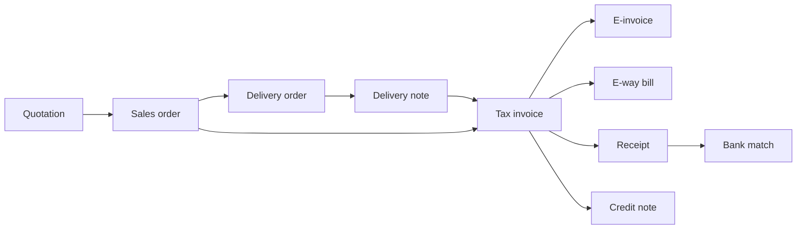

## WF-02 Counter sale (point of sale)

- **Trigger**: A customer buys at a counter; the cashier scans items.
- **Actors and permissions**: Cashier or sales (`sales.*`), manager for discounts and voids.
- **Steps**:
  1. Open a counter session (`POST /pos/sessions`) on a terminal (`/pos/terminals`). [POS-014]
  2. Build the bill with scheme, loyalty, coupon, gift voucher and discount card applied (`POST /pos/bills`); bills can be held and recalled across counters (`/pos/held`). [POS-015, POS-018]
  3. Tender split across cash, card, UPI, store credit; receipt sent by WhatsApp or SMS (`POST /pos/bills/:id/send`).
  4. Return or exchange against a bill (`POST /pos/returns`); an exchange can sit on one bill (plan R1). [POS-016]
  5. Void (`POST /pos/bills/:id/void`) - lifecycle `posBill`: paid to void.
  6. Day close: counter cash counted against the system and signed off (`/pos/day-close`, `/accounts/close`). [FIN-021]
- **Effects on books and stock**: Each bill posts a voucher and a stock movement; the same bill sent twice makes one bill, one voucher and one stock movement (invariant test). [F: plan S2]
- **Offline behaviour**: Allowed offline (`pos.bill`) with the numbers the device was given (`DeviceSeries`). Coupons and gift vouchers are online only.

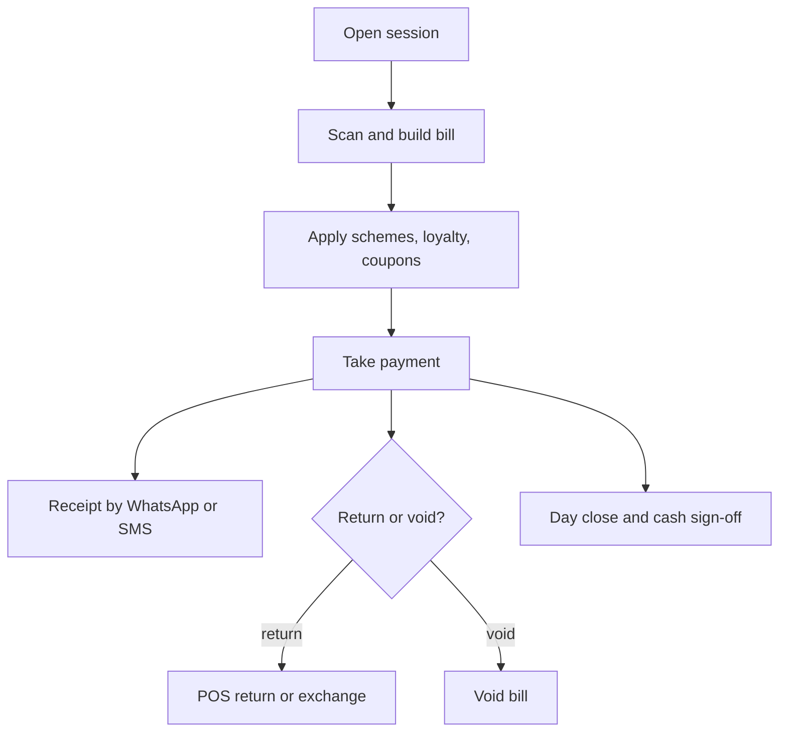

## WF-03 Procure to pay

- **Trigger**: Stock is low (reorder report, MRP) or a buyer orders.
- **Actors and permissions**: Purchase (`purchase.*`), store keeper (`inventory.*`), accountant.
- **Steps**:
  1. Purchase order (`POST /purchase-orders`, close, cancel). [PUR-001]
  2. Goods receipt / inward challan (`POST /goods-receipts`): stock goes up on receipt, the bill comes later; short, damaged or held goods wait on `/goods-receipts/holds` and are released or returned. Lifecycle `goodsReceipt`. [PUR-002]
  3. Purchase bill (`POST /purchase-bills`): posts purchases, input GST and the supplier's account; can be read from a photo or PDF (`POST /purchase-bills/read`, receipt reader). Lifecycle `purchaseBill`. [PUR-004, RPT-008]
  4. Payment against the bill (`POST /bill-receipts` or payment voucher); MSME 45 day ageing report guards the cost deduction. [TAX-012]
  5. Return to supplier (`POST /purchase-returns`, debit note) and supplier claims for short or damaged goods. [PUR-005]
- **Effects on books and stock**: Receipt posts stock; bill posts GL (purchases, input GST, supplier). ITC reversal and Rule 37 (180 day) tracked in the GST workspace.
- **Offline behaviour**: Not available offline (no purchase action in `OFFLINE_ACTIONS`).

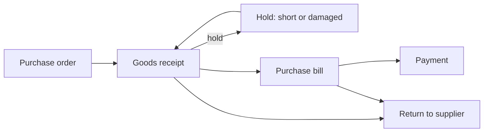

## WF-04 Voucher posting and cancellation

- **Trigger**: Any manual entry: receipt, payment, journal, contra.
- **Actors and permissions**: Accountant (`accounts.create`, `accounts.cancel`).
- **Steps**:
  1. Create (`POST /vouchers`); the voucher must balance (`gl_voucher_balanced` trigger in the database). [FIN-012]
  2. Posted vouchers are never edited; cancel (`POST /vouchers/:id/cancel`) and re-enter (screen text on `/accounts/vouchers`).
  3. Period locks (`/settings/financial-years`, `/settings/process-locks`) refuse posting or cancelling on or before the lock date.
- **Effects on books and stock**: `gl_entries` is insert only (grants), so a cancel posts a reversal; lifecycle `voucher`: posted to cancelled. [F]
- **Offline behaviour**: Allowed offline (`voucher.create`, `voucher.cancel`); the server checks again and applies once.

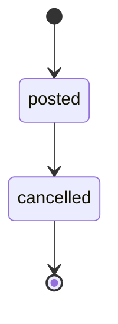

## WF-05 Bank statement reconciliation

- **Trigger**: A bank statement arrives (file import or bank feed).
- **Actors and permissions**: Accountant (`banking.*`).
- **Steps**:
  1. Import statement lines (`/banking/accounts/...` import routes; bank feed adapter is a simulator). [BNK-001]
  2. Rules post known patterns in one click (`/banking/rules`). [BNK-003]
  3. Match a line to a voucher, create an entry from it, unmatch or ignore (`POST /banking/lines/:id/match|create|unmatch|ignore`). [BNK-002]
  4. Gateway payouts (Razorpay, PhonePe, Paytm) settle as one credit (`/banking/settlements`). [BNK-004]
  5. Statement reconciliation runs for customers and suppliers: rules match, exceptions carry a reason, write-offs need approval (`/recon/runs...`). [BNK-005]
- **Effects on books and stock**: Matching links lines to vouchers (`bank_matches`); write-offs post through the approval flow. [F]
- **Offline behaviour**: Online only.

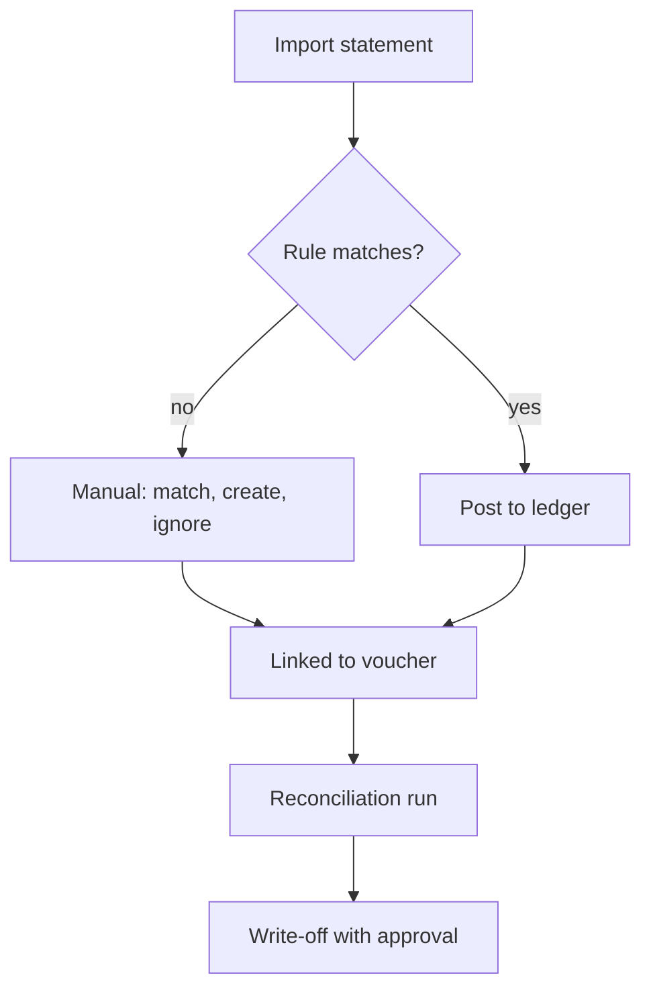

## WF-06 GST compliance cycle

- **Trigger**: Month end; a filing date approaches.
- **Actors and permissions**: Accountant (`gst.*`).
- **Steps**:
  1. Workspace calendar of due dates, e-invoice alerts and slab exceptions (`/gst/work/calendar`, `/gst/work/einvoice-alerts`, `/gst/work/slab-exceptions`). [TAX-011]
  2. Supplier statements: GSTR-2B/IMS import and row decisions, GSTR-2A comparison, Rule 37 (180 day) reversal, Rule 37A, GSTR-9C and GSTR-4 summaries (`/gst/work/...`). [F]
  3. GSTR-1 and GSTR-3B built from invoices and bills (`GET /gst/gstr1`, `/gst/gstr3b`); JSON download for the portal's offline tool. [TAX-004, TAX-005]
  4. Approval workflow around each return, then filing through the GSP adapter (`/gst/portal`, `/gst/filings`; simulator). [TAX-007]
  5. GST journal voucher for adjustments without goods or parties (`/gst-jv`). [TAX-010]
- **Effects on books and stock**: Filing records `gst_filings` and `gst_return_approvals`; ITC reversals recorded in `itc_reversals`.
- **Offline behaviour**: Online only (`gst.einvoice` is declared online only).

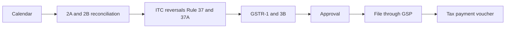

## WF-07 TDS and TCS

- **Trigger**: A payment attracts tax deducted at source, or a sale attracts TCS.
- **Actors and permissions**: Accountant.
- **Steps**:
  1. Preview and record deductions (`/tds/preview`, `/tds/deductions`) with section limits; section 393 map from legacy codes (`/tds/section-map`). [TAX-016, TAX-013]
  2. Challans (`/tds/challans`), Form 26Q (`/tds/26q`), Form 24Q for salary (`/tds/24q`), certificate (`/tds/certificate`, print page). [TAX-018]
  3. 194Q per-seller tracker and TCS on sales (`/tds/194q`, `/tcs`). [TAX-020, TAX-021]
- **Effects on books and stock**: Deductions post to the TDS payable ledger; challan payment clears it. [I]
- **Offline behaviour**: Online only.

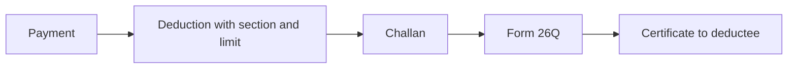

## WF-08 Payroll month

- **Trigger**: Month end.
- **Actors and permissions**: HR (`hr.*`, `payroll.*`).
- **Steps**:
  1. Attendance is marked by hand, imported, or pushed from fingerprint, face or card machines (`/iclock/*`, ZKTeco ADMS protocol); unmarked days count present. [HR-003, HR-019]
  2. Create a run (`POST /payroll-runs`), refresh, edit a payslip, finalise (`/payroll-runs/:id/finalize`). [HR-008]
  3. PF, ESI, professional tax, LWF and TDS are worked out; loans and stipends deducted or paid (`/loans`, `/stipends`).
  4. Pay (`/payroll-runs/:id/pay`) posts to the books; payslips emailed (`/payroll-runs/:id/email`) and printed (`/print/payslip/:id`). Lifecycles `employeeLoan`, `stipendPayment`.
  5. Statutory payments and returns: PF, ESI, PT, LWF, Form 24Q and Form 16 (`/statutory`, `/tds/24q`). [HR-017]
- **Effects on books and stock**: Finalised and paid runs post to salary expense and Salary payable; an integrity check compares them (plan S2). [F]
- **Offline behaviour**: Attendance and leave requests can be done offline; payroll itself is online.

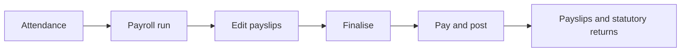

## WF-09 Expense claim

- **Trigger**: A staff member spends money for the business.
- **Actors and permissions**: Any claimant (`expenses.create`); approver (`expenses.approve`).
- **Steps**:
  1. Draft a claim, optionally read from a bill photo (`POST /expenses/claims`; receipt reader is a demo unless a model key is set). [EXP-002]
  2. Submit, approve or reject (`/expenses/claims/:id/submit|approve|reject`); approving books it with GST credit where allowed (section 17(5) blocking is configured per category).
  3. Pay (`/expenses/claims/:id/pay`) settles it; cancel is available. Travel claims are expense claims whose lines carry a trip (`/reports/travel-claims`).
- **Effects on books and stock**: Approval posts the expense and input GST; payment settles the payable. [F: screen text]
- **Offline behaviour**: Claims can be submitted offline (`expense.claim`).

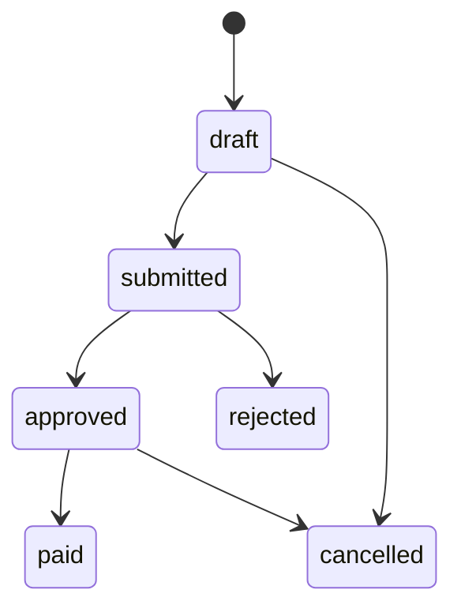

## WF-10 Service desk: repairs, alterations, tailoring

- **Trigger**: A customer leaves a garment or order.
- **Actors and permissions**: Counter staff, karigar (craftsperson) masters.
- **Steps**:
  1. Repair intake with diagnosis, estimate, approval, bench and delivery (`/repairs`, `POST /repairs/:id/act`). Lifecycle `repairJob`. [POS-022]
  2. Alterations: take in, give to a karigar, hand back on the promised day (`/alterations`). [POS-003]
  3. Tailoring orders with measurements, advance, processes through a karigar, bill at delivery (`/tailoring-orders`). [POS-027]
  4. A repair that is ready or handed back queues a WhatsApp and SMS message once each (plan R13).
  5. Customer ledger of deposits held and balance to collect (`/reports/service-customers`). [POS-024]
- **Effects on books and stock**: Repair deposits and charges are tracked on the repair and not posted to the books until billed (screen text on `/sales/repairs`). [F]
- **Offline behaviour**: Online only.

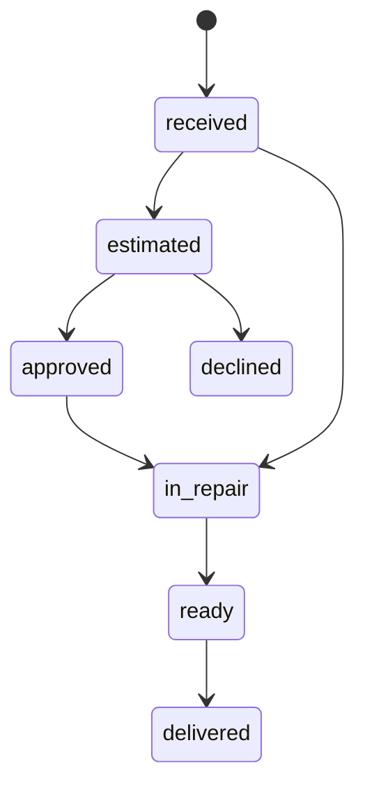

## WF-11 Approval memo (goods on approval)

- **Trigger**: A customer takes pieces to try or show.
- **Actors and permissions**: Sales.
- **Steps**:
  1. Issue a memo (`POST /approval-memos`): pieces move to an 'On approval' warehouse flagged in transit. [POS-004]
  2. Bill what is kept as an invoice; bring back the rest (`POST /approval-memos/:id/return`); invoice within six months (screen text on `/sales/approvals`).
- **Effects on books and stock**: Stock stays on the books until billed or brought back. [F]
- **Offline behaviour**: Online only.

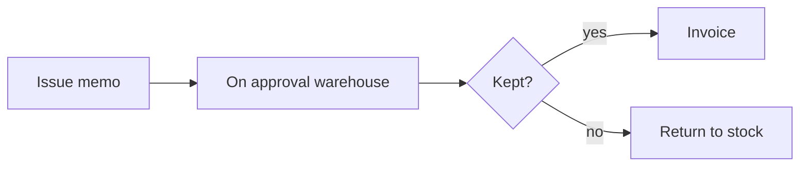

## WF-12 Stock movement, transfer and count

- **Trigger**: Stock moves between stores or is counted.
- **Actors and permissions**: Store keeper (`inventory.*`), approver.
- **Steps**:
  1. Transfer (`POST /stock-transfers`): leaves the source now, in transit until the other side receives (`/stock-transfers/:id/receive`). Lifecycle `stockTransfer`. [INV-030]
  2. Distribution of new stock to stores by demand, ratio or fixed numbers (`/allocations`). [INV-002]
  3. Stock count by scanning (`/stock-counts`, scan, import handheld scans, submit, approve): approving puts the books right. Lifecycle `stockCount`. Spot checks record a difference without adjusting. [INV-022]
  4. Losses with reason and photo; a large loss waits for a second approver (`/stock-losses`). [INV-013]
  5. Journals for opening stock, adjustments and consumption (`/stock-journals`). [INV-008]
- **Effects on books and stock**: Every movement writes `stock_ledger` (insert only). Stock value is not posted to the ledger (plan S2 note). [F]
- **Offline behaviour**: Stock count by scanning is allowed offline (`stock.count`).

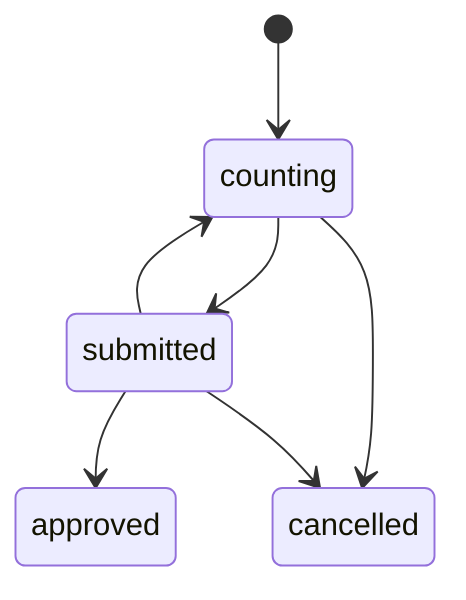

## WF-13 Production and job work

- **Trigger**: A make order or a job-worker process.
- **Actors and permissions**: Production (`inventory.*` and manufacturing routes).
- **Steps**:
  1. Bill of materials with wastage, work-centre time and overheads (`/boms`, `/work-centres`). [MFG-002]
  2. MRP lists what to make and buy for open orders and reorder levels (`/mrp`). [MFG-004]
  3. Production order: plan, release, issue materials, complete (`/production-orders/...`). Lifecycle `productionOrder`. [MFG-003]
  4. Job work challan: send goods, receive processed goods, ITC-04 (`/job-work/send|receive|itc04`); inputs must return within a year (capital goods three). [MFG-005]
- **Effects on books and stock**: Materials leave stock and output comes in at cost (screen text on `/manufacturing/orders`). [F]
- **Offline behaviour**: Online only.

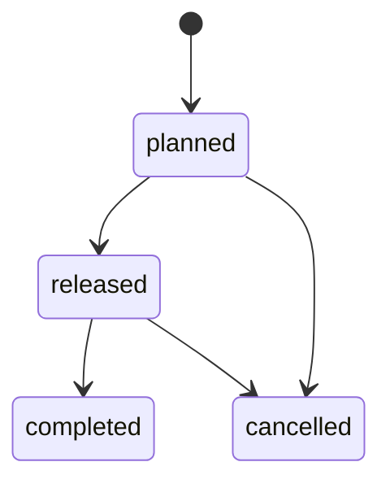

## WF-14 Month close and year end

- **Trigger**: Month or financial year ends.
- **Actors and permissions**: Accountant, owner (`accounts.*`; reopen needs step-up).
- **Steps**:
  1. Checklist of 13 lines (`GET /close/checklist`), sign-offs (`POST/DELETE /close/signoff`), close the month and save report snapshots (`POST /close/month`, `/close/snapshots`). [FIN-020]
  2. Reopening a closed month requires step-up authentication (`POST /close/reopen`).
  3. Year-end check report and carry-forward (`/reports/year-end`, `/reports/carry-forward`); closing locks the year. [FIN-035]
  4. Period locks stop posting on or before a date; process locks close one document kind only.
- **Effects on books and stock**: Locks are enforced on post and cancel; reports saved as snapshots (`report_snapshots`, insert only). [F]
- **Offline behaviour**: Online only (`settings.locks`).

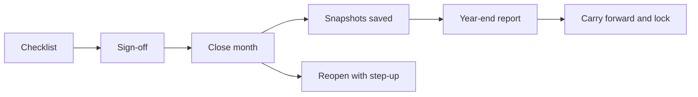

## WF-15 Offline device sync

- **Trigger**: The device app is used with or without a network.
- **Actors and permissions**: Any enrolled device.
- **Steps**:
  1. Enrol the device (`POST /devices`); the server may revoke it (`POST /devices/:id/revoke`, step-up).
  2. Offline actions are queued in the device outbox (`pos.bill`, `voucher.create`, ...).
  3. Push (`POST /sync/push`): the server re-checks each operation and applies it once; refused ones go to `sync_rejections` and the device shows them for edit-and-resend.
  4. Pull (`GET /sync/pull`) returns changes after the device cursor (transaction-id cursor over `sync_changes`). No reference to store scope was found in `routes/sync.ts` (see file 13, Q-31).
- **Effects on books and stock**: Applied operations write the same vouchers, bills and stock rows as online use. [F]
- **Offline behaviour**: This is the offline path. See file 09.

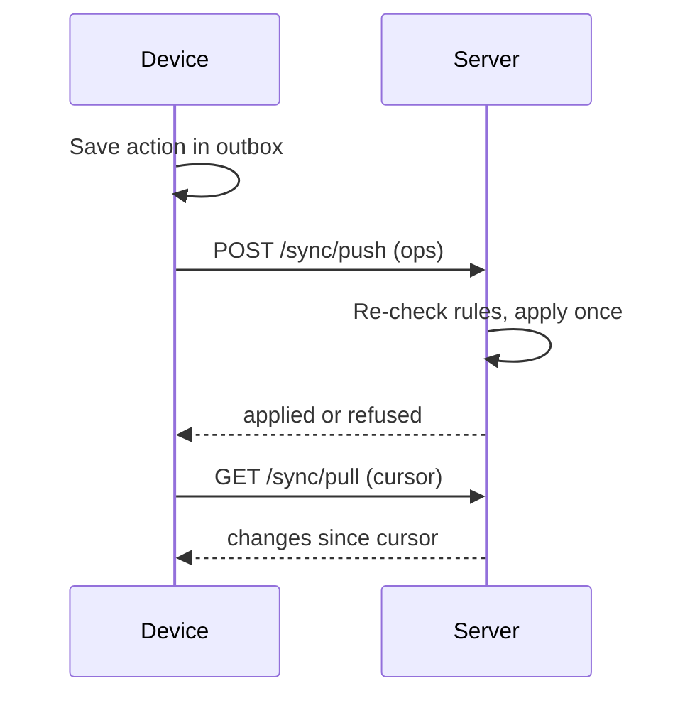

## WF-16 Sign-in, step-up and tenant switch

- **Trigger**: A person opens the app.
- **Actors and permissions**: Anyone.
- **Steps**:
  1. Sign up creates a business and an owner (`POST /auth/signup`); sign in (`POST /auth/login`), sign out, switch business (`POST /auth/switch`), unlock the screen (`POST /auth/unlock`).
  2. Sensitive actions require step-up: the person confirms their password (`POST /auth/step-up`); 5 routes demand it (list in file 07).
  3. Invitations (`/invitations/*`) add a person with a role; password reset by one-time token.
- **Effects on books and stock**: Sessions in `sessions`; permissions loaded per membership; a failed step-up refuses the action. [F]
- **Offline behaviour**: Team admin and settings are online only.

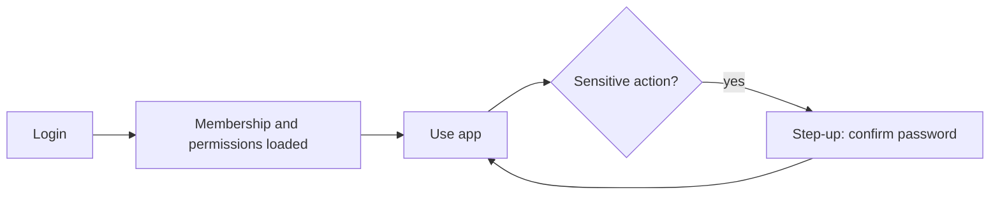

## WF-17 Controlled changes and dated changes

- **Trigger**: Someone changes bank details, credit terms, tax settings, roles, period locks or payroll settings.
- **Actors and permissions**: Requester and a second approver (`special.approveBankChange`, `*.approve`).
- **Steps**:
  1. Settings that need approval (`GET/POST /settings/approvals`) hold a change until a second person decides (`POST /change-requests/:id/decide`). Lifecycle `changeRequest`. [SEC-011]
  2. A GST rate, price, credit terms, a role's permissions or a numbering pattern can be dated to start on a future day (`/config/changes`, table `scheduled_changes`, applied by the 60 second scheduler in `server.ts`).
  3. Segregation of duties, unusual journals, related-party dealings and access reviews are listed under `/settings/controls`.
- **Effects on books and stock**: Every change is written to the audit log; audit entries are sealed into a per-business hash chain. [F]
- **Offline behaviour**: Online only.

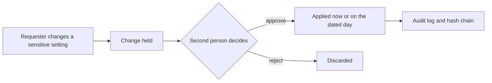

## WF-18 Messages to customers

- **Trigger**: An event happens (bill, repair ready, reminder, broadcast).
- **Actors and permissions**: CRM staff; system.
- **Steps**:
  1. Event raised by the flow (`autoEmit`) according to `comm_settings.auto_events`; reminders by `commreminders`. [CRM-003]
  2. Consent and opt-out checked (`/comms/consents`, `/comms/opt-out`). [CRM-005]
  3. Queue and process (`/comms/queue`, `/comms/process`); WhatsApp templates must be approved by Meta (`/comms/templates`). [CRM-002]
  4. Provider callbacks update delivery (`/webhooks/...`, signed). [CRM-014]
- **Effects on books and stock**: `comm_outbox` records every message and its cost; with no provider keys the demo sender records and reports sent. [F: integrations/messaging.ts, channels.ts]
- **Offline behaviour**: Online only.

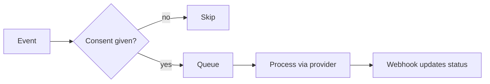

## WF-19 Consignment (shop-in-shop)

- **Trigger**: Goods are kept at another store that sells for you.
- **Actors and permissions**: Sales.
- **Steps**:
  1. Send stock to a consignee, take stock back, and bill what their sales report says was sold (`/consignment/send|return|sales`). [SAL-014]
  2. Terms per consignee: days to settle, rates (`/consignees`); reports of consignment sales by date, discount, branch, brand, item and salesperson. [SAL-012]
- **Effects on books and stock**: Goods stay yours until they sell. Consignment stores are not yet compared against the ledger (plan S2 'Left'). [F]
- **Offline behaviour**: Online only.

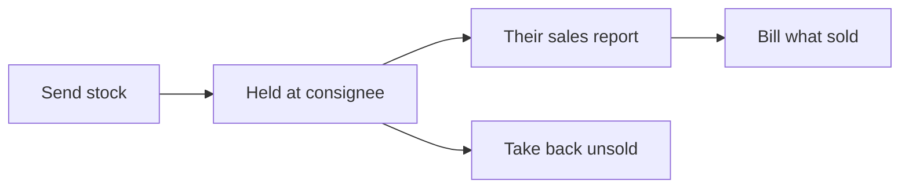

## WF-20 Backup, export and restore test

- **Trigger**: The owner wants their data, or a scheduled backup is due.
- **Actors and permissions**: Owner (`settings.*`); restore test needs step-up.
- **Steps**:
  1. Download all data as files that open without Varchasv (`GET /export/business.zip`) or a locked backup (`POST /export/business.vbk`). [SEC-018]
  2. Verify a backup (`POST /export/verify`) and prove it restores into a separate test business (`POST /export/restore-test`, step-up, passphrase).
  3. Scheduled backups (`/backups`, `/backups/run`, table `backup_settings`, `backup_runs`; run by the scheduler or a cron call). [SEC-010]
- **Effects on books and stock**: Backups are the business's own; restore into the live business is not offered. [F: plan S4]
- **Offline behaviour**: Online only (`settings.backup`).

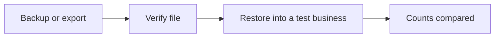

## Written lifecycles [F]

Source: `packages/domain/src/lifecycle.ts` (`LIFECYCLES`). A state outside the list, or a move not listed, is a bug; cancelling or reversing is a state, never a delete. A test drives the first nine documents through posted and cancelled; the plan lists the rest as written but not all driven (S1).

### salesOrder

```mermaid
stateDiagram-v2
  [*] --> open
  open --> partial
  open --> delivered
  open --> closed
  open --> cancelled
  partial --> delivered
  partial --> closed
  partial --> cancelled
  partial --> open
  delivered --> partial
  delivered --> open
```
Terminal states: closed, cancelled

### deliveryOrder

```mermaid
stateDiagram-v2
  [*] --> open
  open --> closed
  open --> cancelled
```
Terminal states: closed, cancelled

### deliveryNote

```mermaid
stateDiagram-v2
  [*] --> posted
  posted --> invoiced
  posted --> closed
  posted --> cancelled
  invoiced --> posted
  closed --> posted
```
Terminal states: cancelled

### stockTransfer

```mermaid
stateDiagram-v2
  [*] --> in_transit
  in_transit --> received
  in_transit --> cancelled
```
Terminal states: received, cancelled

### stockCount

```mermaid
stateDiagram-v2
  [*] --> counting
  counting --> submitted
  counting --> cancelled
  submitted --> approved
  submitted --> counting
  submitted --> cancelled
```
Terminal states: approved, cancelled

### loanRequest

```mermaid
stateDiagram-v2
  [*] --> pending
  pending --> approved
  pending --> rejected
```
Terminal states: approved, rejected

### changeRequest

```mermaid
stateDiagram-v2
  [*] --> pending
  pending --> approved
  pending --> rejected
```
Terminal states: approved, rejected

### stipendPayment

```mermaid
stateDiagram-v2
  [*] --> posted
  posted --> cancelled
```
Terminal states: cancelled

### repairJob

```mermaid
stateDiagram-v2
  [*] --> received
  received --> estimated
  received --> in_repair
  received --> declined
  received --> cancelled
  estimated --> approved
  estimated --> declined
  estimated --> cancelled
  approved --> in_repair
  approved --> cancelled
  in_repair --> ready
  in_repair --> cancelled
  ready --> delivered
  ready --> cancelled
```
Terminal states: delivered, declined, cancelled

### salesInvoice

```mermaid
stateDiagram-v2
  [*] --> posted
  posted --> cancelled
```
Terminal states: cancelled

### purchaseBill

```mermaid
stateDiagram-v2
  [*] --> posted
  posted --> cancelled
```
Terminal states: cancelled

### posBill

```mermaid
stateDiagram-v2
  [*] --> paid
  paid --> void
```
Terminal states: void

### voucher

```mermaid
stateDiagram-v2
  [*] --> posted
  posted --> cancelled
```
Terminal states: cancelled

### goodsReceipt

```mermaid
stateDiagram-v2
  [*] --> posted
  posted --> billed
  posted --> cancelled
  billed --> posted
```
Terminal states: cancelled

### productionOrder

```mermaid
stateDiagram-v2
  [*] --> planned
  planned --> released
  planned --> cancelled
  released --> completed
  released --> cancelled
```
Terminal states: completed, cancelled

### itemVariant

```mermaid
stateDiagram-v2
  [*] --> active
  active --> archived
  active --> merged
  archived --> active
```
Terminal states: merged

### payment

```mermaid
stateDiagram-v2
  [*] --> posted
  posted --> cancelled
```
Terminal states: cancelled

### employeeLoan

```mermaid
stateDiagram-v2
  [*] --> active
  active --> closed
  active --> cancelled
  closed --> active
```
Terminal states: cancelled
