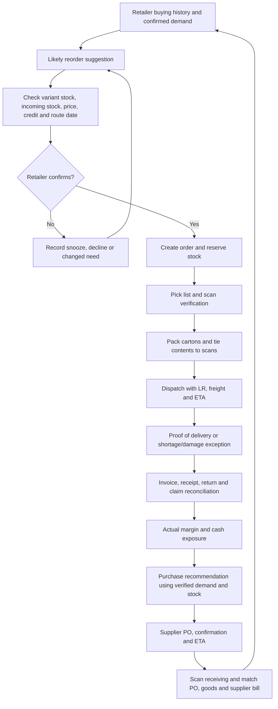
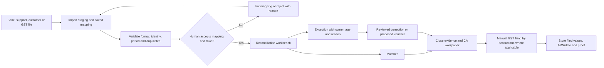
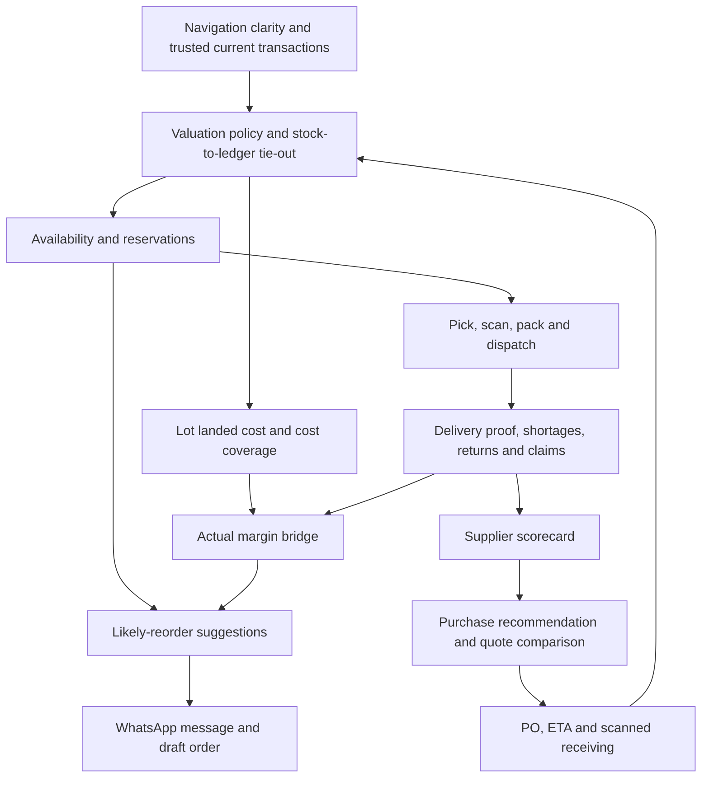
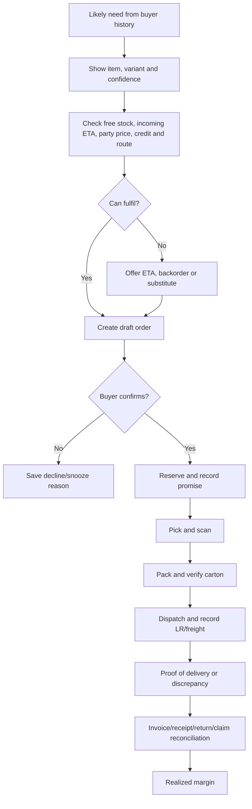
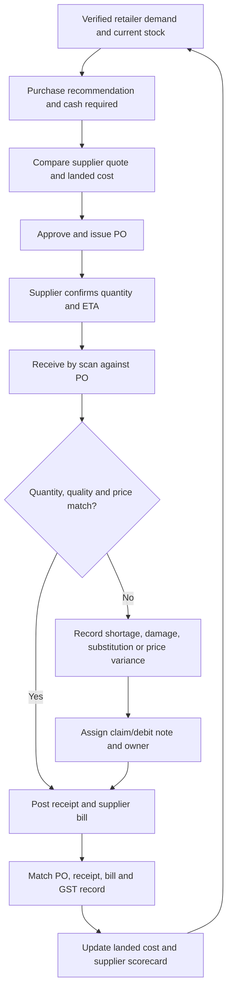

# Varchasv Product Roadmap and Feature Build Schedule

**Planning baseline:** 6 November 2026 product-status inventory and distributor brief 
**Roadmap horizon:** 32 weeks from kickoff, including a 4-week pilot and stabilization window 
**Scope:** one apparel distributor with a large godown, retailers across Assam and nearby North Eastern states, and an accountant who files GST manually

This is a build plan, not a promise of dates. The schedule assumes two workstreams can run in parallel: one focused on the distributor workflow and one on accounting/GST. It also assumes regular access to the business owner and accountant. With one developer doing both workstreams, plan for roughly 40–48 weeks before the pilot is stable.

## 1. Product outcome

Varchasv should help the distributor:

1. Estimate which retailer may need a repeat order.
2. Check the exact stock, price, credit and delivery position before promising it.
3. Pick, pack and dispatch the right variants, recording delivery evidence and exceptions.
4. Measure the actual margin after freight, damage, returns and claim recovery.
5. Use verified demand, stock and supplier reliability to make the next purchase decision.
6. Prepare trustworthy accounting and GST workpapers for review and manual filing.

The product story is the connected workflow. Stock lookup, WhatsApp, barcode scanning, GST exports and margin warnings are already advertised by established vendors as individual capabilities. Varchasv should differentiate through the quality and continuity of the distributor workflow.

## 2. Current product baseline

From the product-status inventory:

- 230 of 268 feature records are marked made. The project definition is a route, screen and test; it does not mean client acceptance or full workflow validation.
- 26 features are backend-only, 8 are partly built, and 4 are simulator/demo features.
- 146 screens loaded in a smoke check. That checks rendering, not the correctness of business rules. Three API tests failed in the full run but passed separately.
- The manual GST workpaper exists but has not been accepted by the current GSTN offline tool or verified with the accountant and real files.
- The distributor-critical items still to build include availability/reservations, warehouse locations and scan verification, delivery discrepancies, supplier ETA/three-way matching, lot-costed margin and reorder suggestions.
- Navigation still has duplicate destinations and six tiles without screens. Several core layouts need phone review.

Treat these counts as a dated inventory, not a product completion percentage. Close the customer workflow gaps before expanding into the broad manufacturing, marketplace, franchise or SaaS plan.

## 3. End-to-end product flow

Accounting, GST and document conversion support the transactions throughout the flow. They should not create separate copies of the same sale, receipt or purchase.

## 4. Build schedule

Each phase ends with a working business outcome and an acceptance gate. Do not call a phase complete because its screens render.

| Phase | Weeks | Main build | Exit gate |
|---|---:|---|---|
| 0. Product readiness | 1–2 | Navigation and billing destination; role work queues; fix integrity text; decide the six missing tiles; review core phone layouts; establish realistic test data; keep the full test suite green; verify manual GST mode and current GST files with accountant | Staff can find one billing path and complete a reviewed sample sale and purchase without simulator claims or confusing duplicate menu entries. GST exports and workpapers have a written acceptance result. |
| 1. Stock and cost foundation | 3–6 | Research-backed periodic valuation defaults; stock identity check; stock-to-ledger tie-out; counted/held/reserved/in-transit states; traceable landed-charge allocation; cost coverage and valuation reporting | One purchase can be received, costed, posted and reconciled to stock and ledger. A physical count variance can be traced to its adjustment. |
| 2. Retailer promise and order | 7–10 | Availability by style/colour/size/location/date; reservations and event rules; backorders; buyer price and credit context; override reason; order timeline and promise log; colour-size order grid if confirmed missing | Two simultaneous orders cannot reserve the same units. Partial fulfilment, cancel/change, credit hold and incoming ETA behave as agreed with the client. |
| 3. Godown and delivery | 11–14 | Bins/locations; pick lists; scan verify; wrong/short/extra item handling; carton contents and packing list; dispatch/LR; freight; proof of delivery; discrepancy owner; return inspection and claim record | A sample order can be picked and packed from scans, dispatched, and reconciled against what was ordered, invoiced and delivered. Exceptions have an owner and evidence. |
| 4. Supplier loop | 15–18 | Supplier terms and lead times; quote comparison; PO confirmation and ETA; scan receiving; shortage/damage/defect codes; PO–receipt–bill match; debit note/claim; supplier scorecard | A sample purchase with a short or damaged receipt creates a traceable exception, correct stock/cost result and supplier follow-up. |
| 5. Margin and reorder rules | 19–22 | Margin bridge labelled actual/allocated/estimated; freight, damage, returns and recoveries; buyer reorder timing with confidence; purchase recommendation using stock, open POs, lead time, size mix and cash required | A sample order shows expected versus realized margin and explains each difference. Reorder output explains its inputs and never claims a buyer is out of stock without buyer-provided sell-through data. |
| 6. WhatsApp v1 | 23–26 | Provider-neutral promise/price/credit/draft-order endpoints; event outbox; consent and opt-out; approved templates; likely-reorder suggestions; availability with ETA/substitutes; order draft and dispatch/POD messages | With provider credentials, an opted-in retailer can receive a relevant message and create a draft order. Without credentials, the core workflow remains usable and the integration is clearly marked unavailable. |
| 7. Release candidate and pilot preparation | 27–28 | Freeze pilot scope; migrate and verify opening data; train staff; prepare rollback/backup and issue triage; confirm accountant and owner sign-off items | Pilot users, sample records, devices, permissions, backups and support owner are ready. No unresolved release-critical data or GST issue. |
| 8. Pilot and stabilization | 29–32 | Run the four-week pilot with real products, buyers, supplier files and godown staff; fix workflow gaps; review margin, availability and scan accuracy; close pilot issues | Owner and staff approve the core retailer and supplier flows using real records. Critical accounting/GST workpapers have accountant sign-off. A measured pilot report supports the next scope decision. |

**Status as of 7 November 2026:** the Phase 1 stock-and-cost implementation slice is coded and verified: a receipt can include allocated inward charges, the stock register ties to Stock-in-Hand through the reviewed close flow, and count variance is covered by tested workflows. Full lot-cost margin reporting, the complete stock identity check, and entity-specific policy/opening-balance review remain open. The broader plan in `docs/distributor-brief-mapping.md` uses “Phase 1” for the separate promise-and-reserve lifecycle; that work remains unimplemented beyond open-order visibility.

### Workstream assumptions

- The table assumes two engineers, one per build lane, with part-time product/QA support. The business owner should give weekly feedback; the accountant should review GST and stock-accounting decisions at the defined gates.
- If only one developer is available, work through the phases sequentially and re-estimate the horizon to 40–48 weeks. Do not promise the parallel schedule to the client.
- Reserve about 15–20% of build capacity for defects, migration, permissions and data cleanup. Do not fill every week with new features.
- External access for WhatsApp, Mulltiply and G-Retail is not a dependency for the core workflow. Build the provider-neutral interface and feature gate; connect a provider only after access and documentation are available.

## 5. Accounting and GST schedule

This is a supporting workstream. Keep manual filing explicit: the ERP prepares, validates and records workpapers; the accountant reviews and files on the GST portal. Do not present a simulator as a live filing connection.

| Timing | Accounting/GST work | Acceptance evidence |
|---|---|---|
| Weeks 1–2 | Confirm filing method is manual; hide the simulator GSP card for manual companies; load the GSTR-1 workbook in the current GSTN offline tool; check 3B JSON keys and 4(D)/4(A)(5) placement with accountant; obtain real GSTR-2B Excel and JSON | Keep the exact tool version, sample files, result, accountant comments and unresolved items with the release record. |
| Weeks 3–6 | Complete stock-to-ledger foundation; build import staging for bank statement, BRS and GSTR-2B; map columns to normalized records; compare ITC by 2B row decision rather than only purchase bill totals | Each import has source file, mapping, preview, validation errors, duplicate handling and human approval. No file silently posts to the ledger. |
| Weeks 7–10 | GSTR-3B side-by-side: ERP, portal-generated values and accountant final values; complete applicable 3.1.1, 3.2 buyer categories, 6.1 detail and 5.1 interest recomputation; ensure 2B decisions feed eligible/reversed/ineligible ITC | Accountant signs off a sample period and explains differences. Applicability of 3.1.1 and other tables is confirmed for the client. |
| Weeks 11–14 | Shared reconciliation workbench for bank, GST, supplier and customer statements; BRS exception queue with owner/age/reason; reviewed proposed vouchers for charges/interest; supplier statement import | Every imported line has a match status, reason and resolution history. Posting is an explicit reviewed action. |
| Weeks 15–18 | Document inbox for purchase invoices and statements; saved bank mappings; BRS PDF/Excel and close evidence; close cockpit with owner/reviewer; CA workpaper export; journal templates and recurring entries | Accountant can trace a workpaper total back to source transactions and review status. BRS is checked against a real statement. |
| Weeks 19–22 | GSTR-1 debit notes and amendments; GSTR-1A corrections if used; GSTR-2B sections beyond B2B, credit/debit notes and IMS decisions; anomaly checks for duplicates, tax and supplier price changes | Test against real supplier/customer documents and one accountant-reviewed return period. Record any formats still unsupported. |
| After pilot | GSTR-9/9C, GSTR-4 summaries, additional annual/composition workflows, advanced approval policies, loan/capex forecasting and broader analytics | Add only after the accountant confirms the client’s filing status and business need. |

### Accounting document flow

The GSTN offline tool uses its own workbook structure and creates JSON. “Excel export” alone is not evidence that the current official utility accepts the file. Preserve the acceptance test and accountant sign-off.

## 6. Feature dependencies

Key dependencies:

- Do not send stock-availability messages until reservations and stock states are reliable.
- Do not call a reorder suggestion a stockout prediction unless the retailer shares sell-through/stock information.
- Do not report actual margin until lot cost, freight and claim outcomes are captured; otherwise label it estimated or allocated.
- Do not auto-post converted files. Stage, preview, reconcile and require review.
- Do not add AI order capture before the order draft API, variant validation and review path are stable.

## 7. Retailer workflow to build

## 8. Supplier workflow to build

## 9. Scope to defer until the distributor pilot proves value

Keep these in the later roadmap unless the client identifies them as an immediate requirement:

- Deep factory features: fabric/trim lots, tech packs, cut-to-pack, advanced job-work and production costing.
- Enterprise channels: marketplaces, Shopify/WooCommerce, franchise and multi-brand management, SaaS billing and a full control tower.
- Advanced intelligence: statistical demand forecasts, size-curve optimization, markdown scenarios, production scheduling and model governance.
- Traceability: provenance, genealogy, circularity and product QR pages.
- Mulltiply integration until API requirements are answered; G-Retail integration until the demo backup is available.
- Voice/photo/handwritten order intake, reply-based approvals and owner digests until the basic WhatsApp order flow is reliable.

This is sequencing, not a cancellation. Revisit parked work after the pilot provides usage evidence.

## 10. Pilot scorecard

Collect a baseline before the pilot and compare it after four weeks:

| Measure | What to observe |
|---|---|
| Stock accuracy | Difference between system quantity and scanned physical count for selected high-movement SKUs |
| Promise accuracy | Orders promised in full/on time versus short, delayed or substituted |
| Pick accuracy | Wrong, missing or extra variants per order/carton |
| Delivery exceptions | Short/damaged claims raised, resolved and recovered |
| Reorder usefulness | Suggestions accepted, changed, snoozed or declined; avoid treating sent messages as success |
| Margin visibility | Share of pilot sales with actual lot cost and known freight/claim outcome |
| Cash tied in stock | Value and age of stock by item/variant, with purchase recommendations reviewed |
| Accounting trust | BRS and GST exceptions with source, owner, age and final resolution |

Do not set success thresholds until the owner supplies a baseline and the team agrees how each metric is calculated.

## 11. Decision gates

1. **Gate 0: Pilot scope:** client confirms buyer types, key brands/variants, invoice timing, route schedule and priority GST filings.
2. **Gate 1: Data and accounting:** Apply the documented research-based valuation and stock-to-ledger defaults; verify real opening stock. Obtain entity-specific accountant review when available, before relying on live financial statements.
3. **Gate 2: Promise:** owner accepts reservation, credit override, partial order and backorder rules.
4. **Gate 3: Godown:** staff can scan receiving, picking and packing on the actual devices and labels used.
5. **Gate 4: Supplier:** owner accepts the claim and three-way match process, including which variances stop payment or require approval.
6. **Gate 5: Reorder:** owner approves the confidence language, consent rules and frequency cap for WhatsApp suggestions.
7. **Gate 6: Release:** accountant validates the manual GST workflow; pilot issues are triaged; simulator and real-provider states are visibly distinct.

## 12. Definition of complete

A feature is ready for the pilot only when:

- The user can complete the business action from the intended screen and role.
- Data changes are reflected in stock, accounting and audit history as expected.
- Failure, partial completion, cancellation and correction paths have defined behavior.
- The workflow has been exercised with realistic records and accepted by its business owner.
- External integrations are identified as live, unavailable or simulated without ambiguity.
- Reports show whether figures are actual, allocated, estimated or accountant-entered.

The project should use this roadmap alongside the dated [product status inventory](E:/varchasverp/docs/product-status-inventory.md) and [distributor brief mapping](E:/varchasverp/docs/distributor-brief-mapping.md). Update the inventory after each accepted milestone rather than marking a feature done when only its UI or API exists.

## 13. Lifecycle control matrix

These are the operating features, failure cases and reconciliation checks for the retailer and supplier lifecycles. A check should identify a specific record, difference, owner and next action; a dashboard total by itself is not a resolution.

### Retailer part 1: need to reservation

| Features | What can go wrong | Reconciliation check |
|---|---|---|
| Availability by style, colour, size and date; buyer price; order grid; credit context; reserve; backorder | The same stock is promised twice | Reserved quantity against on-hand minus held, per variant. Negative free stock is an exception. |
| Same | A salesperson promises on WhatsApp without checking | Promises logged against reservations. A promise without a reservation after a configurable time is flagged. |
| Same | Availability is stale | Each variant shows last count date and last variance. Unreliable figures are marked. |
| Same | Price differs from buyer’s list | Order price against the applicable price-list version. An override requires a reason. |
| Same | Order is released over the credit limit | Order plus open-order exposure plus overdue balance against limit. Overrides record the approver. |
| Same | Reservations remain on held or unconfirmed orders | Reservation-age report with expiry and release action. |

### Retailer part 2: pick to delivery

| Features | What can go wrong | Reconciliation check |
|---|---|---|
| Pick list, scan verify, cartons, transporter and LR, dispatch status, proof of delivery | Wrong or short pick | Reserved quantity against scanned quantity, by picker and variant. |
| Same | Packed contents differ from picked contents | Carton contents against picked scans. |
| Same | Cartons or LR differ from invoice | LR and carton counts against invoice carton details. |
| Same | Freight billed differs from freight recorded | Transporter bill against freight recorded per LR. |
| Same | Short or damaged goods arrive | Dispatched against received-at-delivery quantity. Each difference has an owner and claim deadline. |
| Same | Dispatch is never confirmed | Dispatches without proof of delivery after a configurable number of days. |

### Retailer part 3: invoice to margin

| Features | What can go wrong | Reconciliation check |
|---|---|---|
| Invoice, receipt, collection follow-up, returns inspection, claims, credit, margin | Invoice differs from what shipped | Ordered, dispatched and invoiced quantities; unbilled dispatches and billed-not-dispatched lines. |
| Same | Receipt is unapplied or duplicated | Receipts against bank lines and bill allocations. |
| Same | Credit note is issued without goods being inspected | Credit notes against inspected returns and their stock outcome. |
| Same | Claim is raised but never recovered | Claims raised against recovered amount, with time-bar dates. |
| Same | Margin is incomplete | Share of sales lacking lot cost or freight allocation appears beside the margin. |

### Supplier part 1: decide and order

| Features | What can go wrong | Reconciliation check |
|---|---|---|
| Terms, purchase plan, quote comparison, PO approval | PO exceeds cash plan or approval limit | PO value against cash plan and approver limit. |
| Same | Price moved from quote or last buy | PO rate against the selected quote and last purchase rate. |
| Same | Duplicate open PO exists | Open POs for the same supplier and variant. |
| Same | Stock position used for planning was unreliable | Recommendation inputs show count confidence and all open/incoming POs. |

### Supplier part 2: confirm, track, receive

| Features | What can go wrong | Reconciliation check |
|---|---|---|
| Confirmation, ETA, scan receiving, shortage, damage and hold | Supplier confirms less than ordered | PO quantity against supplier confirmation. |
| Same | Delivery is late or partial | Expected against actual arrival. A slipped ETA updates incoming stock in retailer availability. |
| Same | Goods differ from order | Scanned against ordered; shortage, excess and substitution are separate lines. |
| Same | Damaged goods become saleable | Held stock is excluded from available stock and has a claim deadline. |

### Supplier part 3: match, pay, learn

| Features | What can go wrong | Reconciliation check |
|---|---|---|
| Bill match, landed cost, payment, supplier statement, scorecard | Bill differs from what arrived | Ordered, received and billed, compared on quantity, rate and tax. |
| Same | ITC is treated as available when supplier invoice is missing from GSTR-2B | Bills against GSTR-2B. Missing records enter the GST workpaper as ITC at risk for accountant review. |
| Same | Freight is omitted from cost | Freight bills against lot cost. |
| Same | Shortage is paid for without recovery | Debit note/claim against each shortage before payment approval. |
| Same | Business dues differ from supplier statement | Supplier statement against ledger and payments. |

### Invariants across all six parts

- Supplier receiving updates retailer availability: incoming dates change when confirmations slip, and held goods never count as sellable.
- Stock identity must hold per variant and location: **free + reserved + held + in transit = on hand + incoming**, using one clearly defined convention for each term. A broken identity is an exception.
- Lot cost and landed cost feed the retailer margin bridge. This is why stock valuation and stock-to-ledger controls precede margin analytics.
- An exception must retain source documents, event history, owner, due date, resolution and any approval.

## 14. WhatsApp, AI and system ownership

### Responsibility split

| System | Owns |
|---|---|
| Varchasv | Source of truth for variant availability, buyer price, credit, orders, reservations, exceptions, permissions and audit history. |
| WhatsApp provider / Mulltiply, if selected and integration is confirmed | Number, approved templates, delivery of messages, inbound channel and campaign transport. It may classify or route inbound messages but must call Varchasv for business facts. |
| AI service | Read inbound content, extract structured drafts and explain computed results. It does not invent stock, price, credit, ETA, tax or margin figures. |

**Rule:** AI may read and draft. Every business number shown in a message must come from a permission-checked Varchasv query. Mulltiply integration depends on API and account requirements being confirmed; it is not a core-workflow blocker.

### Retailer part 1: need to reservation

| WhatsApp experience | AI assistance |
|---|---|
| Retailer or salesman sends text, voice or handwritten list; a draft order appears in the colour-size grid. | Parse order lines and show confidence per line; ask about unclear item, size or quantity instead of guessing. |
| Availability reply per variant, including ETA. | Suggest an in-stock substitute by similar style, colour or size; require buyer confirmation. |
| Send backorder update, such as “M is short; 40 are expected on 12 Nov.” | Notice a missing size in a usual size run and ask whether the buyer wants a substitute or backorder. |
| Credit hold is routed to salesperson/owner for review, not disclosed as sensitive account detail to the retailer. | “Likely due to reorder” suggestion shows the buying-history reason and confidence. |

### Retailer part 2: pick to delivery

| WhatsApp experience | AI assistance |
|---|---|
| Alert salesperson about a pick shortage before dispatch and capture “ship partial” or “wait.” | Classify retailer reply as received in full, short or damaged; create a draft discrepancy for review. |
| Dispatch message includes transporter, LR, carton count and ETA. | Read an LR or challan photo into a draft dispatch record with source image retained. |
| Request proof of delivery; allow short/damage reports with photos and create an owned discrepancy. | Estimate route/transporter delay risk from recorded history; label it as a risk estimate, not a guaranteed ETA. |

### Retailer part 3: invoice to margin

| WhatsApp experience | AI assistance |
|---|---|
| Send invoice PDF, due-date reminder and receipt acknowledgement. | Prioritize collection by amount, age and recorded broken payment promises. |
| Answer “What’s my balance?” using a permission-checked, read-only ledger query. | Capture “will pay Friday” as a proposed promise-to-pay date for staff confirmation. |
| Receive return/damage requests with photos and link them to the order/invoice. | Explain margin figures to the owner using computed amounts and source transactions. |

### Supplier parts 1, 2 and 3

| Part | WhatsApp experience | AI assistance |
|---|---|---|
| 1: decide/order | Send PO or quote request. | Draft PO quantity with reasons and cash requirement; extract supplier price list from photo/PDF into a review screen. |
| 2: confirm/receive | Capture supplier confirmation, ETA, late reminders, shortage and damage notices with photos. | Extract confirmed quantities and dates; estimate late-delivery risk from actual lead-time history. |
| 3: match/pay/learn | Request supplier statement; send payment advice/UTR after approval. | Draft bill from a supplier invoice image in the document inbox; draft a dispute message; summarize scorecard facts. |

### Owner and approval interactions

- Daily digest of open exceptions, cash position and margin leaks.
- Reply-based approvals may be offered for credit override or discount only when the reply maps to a verified user and the approval is recorded with the document.
- Read-only questions such as “stock of style 514?” or “what does Rahman Traders owe?” are answered from permission-checked Varchasv queries.

### Messaging and AI guardrails

- Separate consent by category: restock alerts, offers and transaction updates. Honour opt-out and record when consent was granted or withdrawn.
- Use provider-approved templates when required outside the active reply window.
- A person approves initial campaign messages and any message involving price, discount or credit.
- Salesman/chat assistants cannot override price or credit rules.
- Link every inbound/outbound message to the matched buyer and related order/exception; retain the audit trail.
- Map phone numbers to retailer accounts carefully. If a number matches multiple accounts or is uncertain, do not reveal price, credit or balance; route for confirmation.

### Build order for the integration boundary

1. Promise lookup by variant and date.
2. Buyer-specific price and credit checks.
3. Endpoint that converts validated structured lines into a draft order.
4. Event outbox for dispatched, short, due and back-in-stock events, mapped to templates.
5. Consent registry, opt-out handling and recipient identity checks.
6. Provider adapter and delivery receipts, only after credentials/templates/API details are available.
7. AI parsing for text/voice/photo; expose confidence and require correction for uncertain lines.

## 15. Recommended feature additions to validate

These are candidates, not automatically committed scope. Validate the pain and frequency with the distributor before placing them into a release milestone.

### Retailer-side candidates

| Candidate | How it works | Purpose / priority |
|---|---|---|
| Unmet-demand and lost-sale register | When a requested variant is unavailable, record buyer, style/colour/size, quantity, date and outcome: backorder, substitute, lost sale or notify-on-restock. | High. Turns missed orders into a measurable demand signal for buying and restock alerts. |
| Route-day and order cut-off promise | Maintain delivery beats, dispatch days, order cut-off times and lane-level delivery history. Show the next feasible date and confidence with the availability response. | High for a distributor serving many towns. Prevents a stock promise from being mistaken for a delivery promise. |
| Buyer ordering profile | Store pack multiples, minimum order, preferred brands, permitted substitutes, usual size ratios and delivery instructions. Apply them to the order grid but allow reviewed exceptions. | High if retailers routinely order in fixed packs or ratios. Reduces order entry and picking errors. |
| Credit exposure reservation | Reserve credit exposure for confirmed open orders as well as posted invoices; release or update it on cancellation, dispatch, invoicing and payment. | High. Prevents two sales channels from independently using the same remaining credit. |
| Return authorization before credit | Create a return request tied to original invoice/variant; approve return, receive and inspect, choose restock/hold/write-off, then prepare a credit-note draft. | High. Keeps credit notes tied to physical goods and inspection outcome. |
| Campaign outcome and contact-frequency report | Track eligible audience, sent/delivered/replied/ordered and resulting margin; apply per-category frequency caps and quiet periods. | Medium. Shows whether a restock message earns an order without spamming buyers. |
| Buyer service scorecard | Track fill rate, on-time delivery, claims, returns, payment behaviour and unresolved issues by buyer. | Later. Helps sales staff prepare for a visit or collection conversation with context. |

### Supplier-side candidates

| Candidate | How it works | Purpose / priority |
|---|---|---|
| Supplier pack, UOM and scheme rules | Store supplier SKU mapping, case/piece conversion, size ratio, MOQ, free-goods scheme, quote validity and effective-date price list. | High where suppliers sell in packs or use changing schemes; avoids wrong quantity and cost comparisons. |
| Carton pre-advice | Let supplier send expected carton count/content/barcodes before arrival; compare it with the PO and scan receipt. | Medium. Speeds receiving and identifies shortages before the vehicle is unloaded. |
| Replacement and supplier-return workflow | Track whether damaged/incorrect stock will be replaced, returned, credited or written off; link replacement receipt to original claim. | High if current claims often remain open or replacements are delayed. |
| Payable proposal with disputed split | Propose due payments from terms and cash plan; separate disputed quantities/amounts from undisputed payable and show early-payment discount if applicable. | Medium. Supports cash planning without accidentally paying a disputed shortage. |
| ETA confidence by supplier/lane | Compare promised and actual dates by supplier and delivery lane; update incoming dates and show the reliability behind an ETA. | Medium. Improves retailer promises and purchase choices. |
| Alternate supplier and substitution map | Link equivalent approved products/variants and supplier sources with price, quality and lead-time constraints. | Later. Helps respond to shortages without accepting an unapproved substitute. |

### Cross-cutting candidates

- **Risk-based cycle count queue:** prioritize variants with high value, fast movement, repeated variance, stale count date or current reservation exposure. Use blind recount and record who counted.
- **One exception queue:** rank stock, delivery, payment, GST and supplier issues by amount at risk, age, deadline and customer impact; give each one an owner and next action.
- **Evidence timeline:** keep message, photo, scan, invoice, LR, statement and approval evidence attached to the relevant order, purchase or claim.
- **Sales incentive on collected contribution:** if commissions are used, let the owner compare billing-based incentives with collected margin after discounts, claims and returns. Keep the current commission rules configurable.

The first additions I would validate with the client are **unmet-demand capture, route-day promises, buyer ordering constraints, credit exposure reservation, and replacement tracking**. They strengthen the existing flow and improve the data behind replenishment. Do not schedule every candidate until the owner confirms which problems happen often enough to justify them.
